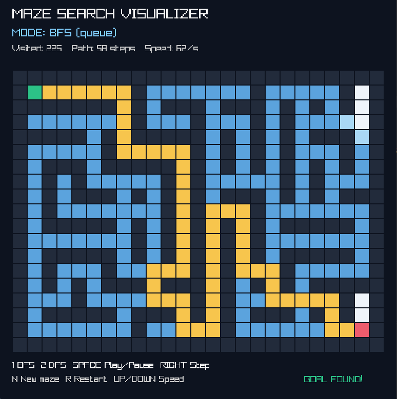
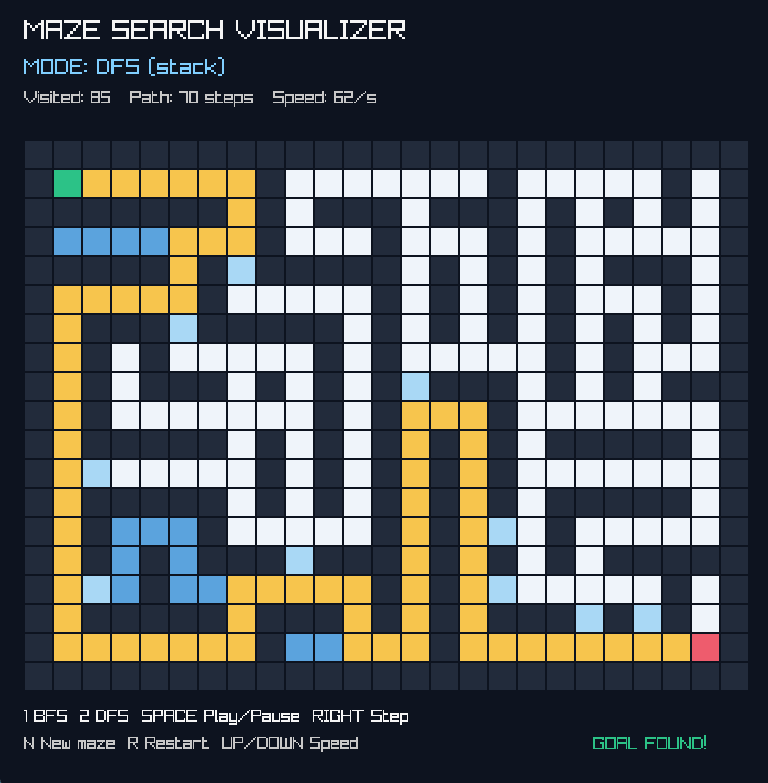

# Maze Pathfinding Visualizer

An interactive maze generation and pathfinding visualization built with **C++17 and raylib**.

This project demonstrates how Breadth-First Search (BFS) and Depth-First Search (DFS) explore a maze and find a path from start to finish.

## Screenshots

### BFS Visualization



### DFS Visualization



## Features

- Random maze generation
- Interactive BFS and DFS visualization
- Step-by-step pathfinding animation
- Adjustable visualization speed
- Pause and resume functionality
- Path reconstruction and highlighting
- Exploration statistics

## Algorithms

| Algorithm | Data Structure | Shortest Path |
|---|---|---|
| BFS | Queue | Yes (unweighted maze) |
| DFS | Stack | Not guaranteed |

Both algorithms have a time complexity of **O(V + E)**, where V represents vertices and E represents edges.

## Controls

| Key | Action |
|---|---|
| 1 | Select BFS |
| 2 | Select DFS |
| Space | Start / Pause |
| Right Arrow | Step forward |
| Up / Down | Change speed |
| R | Restart search |
| N | Generate new maze |

## Build Instructions

### Requirements

- C++17 compiler
- CMake
- raylib

### Build

```bash
cmake -S . -B build
cmake --build build --config Release
```

On Windows with MinGW Makefiles, the executable is typically located at:

```text
build/maze_visualizer.exe
```

## Learning Objectives

This project explores:

- Graph traversal algorithms
- Queue and stack behavior
- Maze representation using 2D grids
- Parent tracking and path reconstruction
- Real-time algorithm visualization

## Technologies

- C++17
- raylib
- CMake
- Git